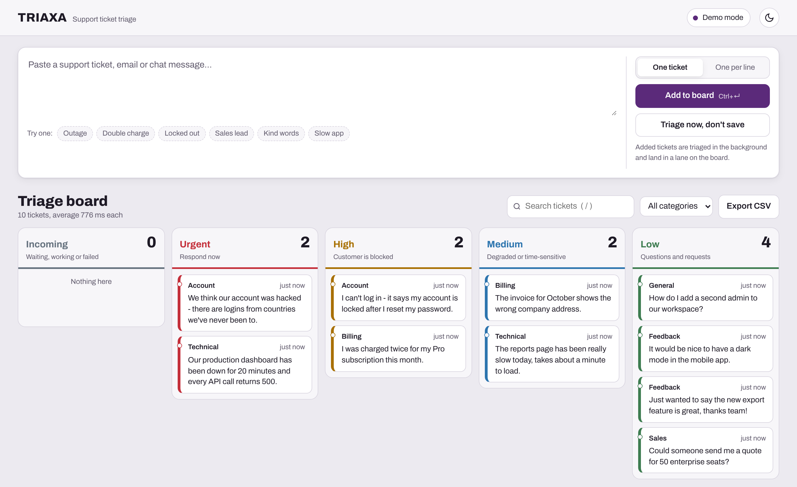
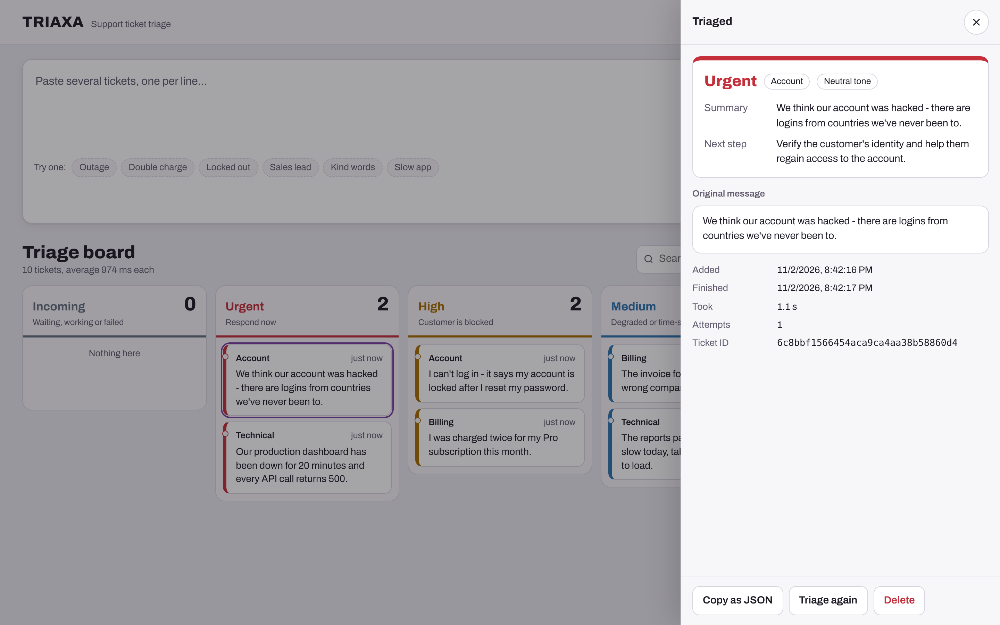
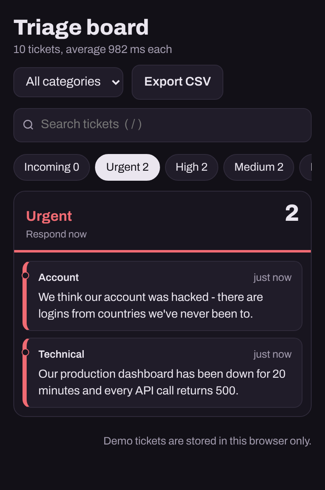
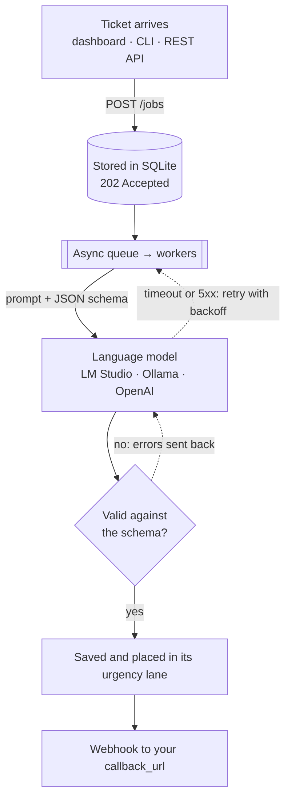

<div align="center">


# Triaxa

**AI triage for support tickets.**<br>
Paste any customer message. Triaxa reads it with a language model and returns the category, urgency, tone,<br>
a one-line summary and the next step for your team: validated, queued and sorted onto a board.

[](https://github.com/valentinakiyungi/triaxa/actions/workflows/ci.yml)
[](https://github.com/valentinakiyungi/triaxa/actions/workflows/pages.yml)
[](https://www.python.org/)
[](https://fastapi.tiangolo.com/)
[](LICENSE)

[**Live demo**](https://valentinakiyungi.github.io/triaxa/) &nbsp;•&nbsp;
[Quick start](#quick-start) &nbsp;•&nbsp;
[How it works](#how-it-works) &nbsp;•&nbsp;
[API](#api) &nbsp;•&nbsp;
[Deploy](#deployment)

<br>

<picture>
  <source media="(prefers-color-scheme: dark)" srcset="docs/board-dark.png">
  
</picture>

</div>

---

## Why Triaxa

A support inbox mixes production outages with password resets, refund requests and thank-you notes, and someone
has to read every message to decide what comes first. Triaxa does that first read for you:

- **Every ticket gets the same structured record:** category, urgency, sentiment, summary and recommended action, enforced by a schema rather than hoped for in a prompt.
- **It runs on your own model.** Point it at LM Studio or Ollama on your laptop and ticket text never leaves your machine, or use any OpenAI-compatible API.
- **It's built to sit in a real workflow:** a persistent queue with retries, webhooks for your helpdesk, a REST API, a CLI and a dashboard your team can use as-is.

## See it in action

<div align="center">
  
</div>

<table>
  <tr>
    <td width="68%" valign="top"></td>
    <td width="32%" valign="top"></td>
  </tr>
  <tr>
    <td align="center"><sub>Open any ticket for its summary, next step and history</sub></td>
    <td align="center"><sub>Works on phones, in light and dark</sub></td>
  </tr>
</table>

## Highlights

| Feature | What you get |
|---|---|
| **Triage board** | Tickets land in *Urgent*, *High*, *Medium* and *Low* lanes as they're processed. Search, filter by category, re-run, delete, copy as JSON, export to CSV. |
| **Guaranteed structure** | Requests JSON-schema output, validates it with Pydantic, and when a model slips it sends the validation errors back and asks again. Falls back gracefully on servers without `json_schema` support. |
| **Any OpenAI-compatible model** | LM Studio, Ollama, vLLM, llama.cpp server or OpenAI. `LLM_MODEL=auto` picks up whatever model is loaded. |
| **Durable async queue** | Jobs are stored in SQLite before they run, processed by concurrent workers, retried with exponential backoff, and resumed after a restart. |
| **Integrations** | REST API with OpenAPI docs, batch submission, webhooks on completion, search, stats, optional API-key auth, CLI client. |
| **Runs anywhere** | One `uvicorn` command, a Docker image, or the dashboard alone on GitHub Pages with an in-browser demo mode. |

## Quick start

### Try it in your browser

Open the **[live demo](https://valentinakiyungi.github.io/triaxa/)** and click *Add 6 sample tickets*. The demo runs a
keyword classifier in your browser, so there's nothing to install. Connect it to your own server for real LLM results
(see [GitHub Pages](#github-pages)).

### Run it locally

Requires Python 3.10+.

```bash
git clone https://github.com/valentinakiyungi/triaxa.git
cd triaxa
python3 -m venv venv && source venv/bin/activate     # Windows: venv\Scripts\activate
pip install -r requirements.txt
cp .env.example .env
```

Start a model server, then Triaxa:

```bash
uvicorn main:app --reload --port 8000
```

Open **http://127.0.0.1:8000** for the board, or **http://127.0.0.1:8000/docs** for interactive API docs.

<details>
<summary><b>Choosing a model server</b></summary>

<br>

| Server | Setup | `.env` |
|---|---|---|
| **LM Studio** | Load a model (Llama 3.1, Qwen 2.5, Mistral…), open *Developer* and start the server | defaults work as-is |
| **Ollama** | `ollama pull llama3.1` | `LLM_BASE_URL=http://127.0.0.1:11434/v1`<br>`LLM_MODEL=llama3.1` |
| **OpenAI** | Create an API key | `LLM_BASE_URL=https://api.openai.com/v1`<br>`LLM_API_KEY=sk-…`<br>`LLM_MODEL=gpt-4o-mini` |
| **No model** | — | `LLM_PROVIDER=mock` runs the keyword classifier |

Instruction-tuned models of 7B parameters or more give dependable results. Smaller models work too, because the
validation loop repairs most formatting slips.

</details>

### Or with Docker

```bash
docker compose up --build
```

The container reaches LM Studio or Ollama on your host through `host.docker.internal` and keeps job history in the
`triaxa-data` volume.

## How it works



1. **Accept.** A ticket arrives through the API, the CLI or the board. It's written to SQLite and acknowledged immediately with `202 Accepted`.
2. **Analyze.** A worker sends it to the model with a strict JSON schema of the allowed categories, urgency levels and tones.
3. **Validate.** The reply is parsed and checked with Pydantic. If the JSON is malformed or uses an unknown value, the errors go back to the model for a corrected answer.
4. **Recover.** Timeouts, 5xx responses and a model that's still loading are retried with exponential backoff. Permanent errors fail fast with a clear message. Jobs interrupted by a restart are picked up again.
5. **Deliver.** The result is saved, shown on the board in its urgency lane and, if you passed a `callback_url`, posted to your webhook.

## What you get back

```json
{
  "id": "5f0c2a…",
  "status": "completed",
  "text": "Our dashboard is down and every API call returns 500!",
  "result": {
    "category": "Technical",
    "urgency": "Urgent",
    "sentiment": "Negative",
    "summary": "The customer's dashboard is down and all API calls return HTTP 500 errors.",
    "action_item": "Escalate to on-call engineering and check API service health."
  },
  "attempts": 1,
  "metadata": { "ticket_id": "T-1042" },
  "duration_ms": 2140,
  "created_at": "2026-11-02T09:14:03.120Z",
  "completed_at": "2026-11-02T09:14:05.260Z"
}
```

| Field | Values |
|---|---|
| `category` | `Billing` · `Technical` · `Account` · `Sales` · `Feedback` · `General` |
| `urgency` | `Urgent` (outage, data loss, security, legal or financial deadline) · `High` (customer blocked) · `Medium` (degraded or time-sensitive) · `Low` (questions, requests, feedback) |
| `sentiment` | `Positive` · `Neutral` · `Negative` |
| `status` | `queued` · `processing` · `completed` · `failed` |

## API

| Method | Path | Description |
|---|---|---|
| `POST` | `/analyze` | Triage one text and wait for the result (not stored) |
| `POST` | `/jobs` | Queue one text; returns `202` with the job |
| `POST` | `/jobs/batch` | Queue up to 100 texts in one call |
| `GET` | `/jobs` | List jobs; filter by `status`, `category`, `urgency`; search with `q`; paginate with `limit` and `offset` |
| `GET` | `/jobs/{id}` | Get one job and its result |
| `POST` | `/jobs/{id}/retry` | Re-run a completed or failed job |
| `DELETE` | `/jobs/{id}` | Delete a job |
| `GET` | `/stats` | Totals by status, category and urgency, queue depth, average processing time |
| `GET` | `/health` | Liveness |
| `GET` | `/health/ready` | Readiness: returns `503` if the model server is unreachable |

**Queue a ticket with a webhook**

```bash
curl -X POST http://127.0.0.1:8000/jobs \
  -H 'Content-Type: application/json' \
  -d '{
        "text": "Our dashboard is down and every API call returns 500!",
        "metadata": {"ticket_id": "T-1042"},
        "callback_url": "https://example.com/hooks/triage"
      }'
```

**From Python**

```python
import time, requests

API = "http://127.0.0.1:8000"
job = requests.post(f"{API}/jobs", json={"text": "I was charged twice this month"}).json()

while job["status"] in ("queued", "processing"):
    time.sleep(1)
    job = requests.get(f"{API}/jobs/{job['id']}").json()

print(job["result"]["urgency"], "-", job["result"]["action_item"])
```

If `API_KEY` is set on the server, send it with every request in the `X-API-Key` header.

## Command-line client

`test_client.py` covers the whole API from the terminal:

```bash
python test_client.py                                    # queue 5 sample tickets and print the results
python test_client.py analyze "I was charged twice this month"
python test_client.py submit "Login page shows a 500 error" --wait
python test_client.py batch tickets.txt --wait           # one ticket per line, or '-' for stdin
python test_client.py list --urgency Urgent
python test_client.py health
```

Use `--url` or `TRIAXA_URL` to point it at another server, and `--api-key` or `TRIAXA_API_KEY` for authentication.

## Configuration

Settings come from environment variables or a `.env` file. Every one has a working default; see [`.env.example`](.env.example).

<details>
<summary><b>All settings</b></summary>

<br>

| Variable | Default | Description |
|---|---|---|
| `LLM_PROVIDER` | `openai` | `openai` for any compatible server, or `mock` |
| `LLM_BASE_URL` | `http://127.0.0.1:1234/v1` | Model server URL (`OPENAI_API_BASE` is also accepted) |
| `LLM_API_KEY` | `not-needed` | Key for the model server (`OPENAI_API_KEY` is also accepted) |
| `LLM_MODEL` | `auto` | Model name; `auto` uses the first model the server reports |
| `LLM_TEMPERATURE` | `0.0` | Sampling temperature |
| `LLM_TIMEOUT_SECONDS` | `120` | Timeout per model request |
| `LLM_MAX_VALIDATION_RETRIES` | `2` | Corrections requested when output fails validation |
| `WORKER_CONCURRENCY` | `2` | Tickets processed in parallel |
| `MAX_JOB_ATTEMPTS` | `3` | Attempts before a job is marked failed |
| `RETRY_BACKOFF_SECONDS` | `2` | First retry delay, doubled after each attempt |
| `MAX_BATCH_SIZE` | `100` | Maximum items per batch request |
| `MAX_TEXT_LENGTH` | `20000` | Maximum characters per ticket |
| `DATABASE_PATH` | `data/triaxa.db` | SQLite database file |
| `API_KEY` | *unset* | When set, every API call must send `X-API-Key` |
| `CORS_ORIGINS` | `*` | Comma-separated origins allowed to call the API |
| `LOG_LEVEL` | `INFO` | Logging level |

</details>

> [!TIP]
> Local model servers usually generate one response at a time. Keep `WORKER_CONCURRENCY` at 1–2 for LM Studio and
> raise it for vLLM or hosted APIs.

## Deployment

### GitHub Pages

The dashboard is a single static file, published from `app/static/` by
[`.github/workflows/pages.yml`](.github/workflows/pages.yml) whenever it changes on `main`.
To enable it, open **Settings → Pages** and set *Source* to **GitHub Actions**.

GitHub Pages serves static files only, so the hosted dashboard has two modes, switched from the status button in its top bar:

- **Demo in this browser** (default): a JavaScript keyword classifier, with tickets stored in the visitor's browser.
- **Triaxa server**: enter a server address such as `http://127.0.0.1:8000` to triage with a real model. CORS and
  Private Network Access are enabled for this. Chrome, Edge and Firefox allow an HTTPS page to reach `127.0.0.1`;
  Safari doesn't, so use another browser or serve the API over HTTPS.

When Triaxa serves the dashboard itself, it connects to that server automatically.

### Production checklist

- Set `API_KEY` on any server that's reachable from a network, and restrict `CORS_ORIGINS` to your dashboard's address.
- Put the API behind HTTPS (Caddy, nginx or your platform's load balancer).
- Mount a persistent volume for `DATABASE_PATH` and back it up.
- Match `WORKER_CONCURRENCY` to what your model server can handle in parallel.
- Use `/health/ready` for readiness checks so traffic waits until the model is reachable.

## Project structure

```
triaxa/
├── app/
│   ├── main.py          FastAPI app, routes and lifecycle
│   ├── pipeline.py      async queue, workers, retries and webhooks
│   ├── llm.py           OpenAI-compatible analyzer with validation loop; mock analyzer
│   ├── store.py         SQLite persistence and search
│   ├── schemas.py       Pydantic models for the API and the LLM output
│   ├── config.py        settings from environment variables
│   └── static/          the dashboard, also deployed to GitHub Pages
├── tests/               pytest suite
├── docs/                README images
├── main.py              entry point for `uvicorn main:app`
├── test_client.py       command-line client
├── Dockerfile
└── docker-compose.yml
```

## Development

```bash
pip install -r requirements-dev.txt
pytest -q
```

The suite needs no model. It drives the API with the mock analyzer and the LLM client with a fake
OpenAI-compatible server, covering:
- validation retries and response-format fallback
- error classification and model auto-detection
- job retries and crash recovery
- webhooks, search, authentication and CORS

CI runs it on Python 3.10, 3.12 and 3.13 for every push.

## Contributing

Issues and pull requests are welcome. For larger changes, please open an issue first to discuss the approach.
Run `pytest -q` before submitting, and add tests for new behaviour.

## License

[MIT](LICENSE) © 2026 Valentina Kiyungi
